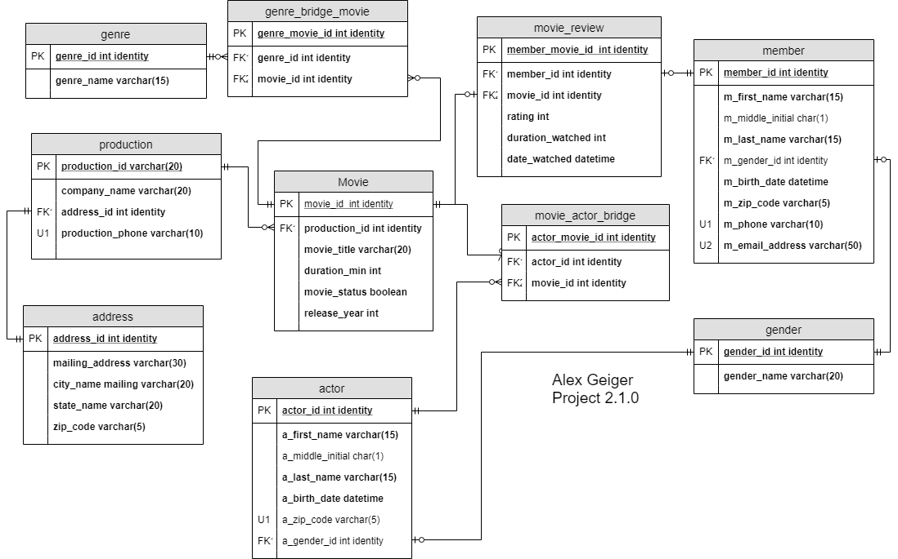

# Movie inventory database

IST 659, Data Administration Concepts and Database Management.

I built a member-facing movie inventory database, in the same general vein as IMDb. Members could rate movies and record what they watched. From there I ran SQL and R analysis on production companies, genre, and ratings by gender.

The schema is in third normal form, with integer identity primary keys. I loaded simulated data, wrote views, procedures, and functions, and put a Microsoft Access form in front of it for editing records.

The writeup is in [reports/Project_2_1.pdf](reports/Project_2_1.pdf). The cover page says IST 658, but the course and the SQL headers are IST 659.

## Results

These numbers are from the simulated data I loaded, not from real movies.

- The actors with the most comedy credits were tied at two movies each: Chris Navan, Egg Milk, Uni Eldino, and Zach Dandino.
- *Or Did He* had the most female views (more than six members; the ratings-by-movie chart shows eight views).
- *The Man Who Knew SQL* had a five-star rating.
- In the SQL questions, High Water was the highest-rated production company, with a rating of 3.
- In the genre chart, action came out on top. Female members both rated more often and gave higher ratings.

## Tools

SQL Server, Microsoft Access, and R (RODBC, dplyr, ggplot2).

## Files

- `code/main.sql`: full script (tables, data, and later objects)
- `code/design/Physical_Database_Design.sql`: tables
- `code/simulation/simulated_data.sql`: inserts
- `code/engineering/data_engineering.sql`: views, functions, procedures, and the data questions
- `code/analysis/`: R plots
- `docs/logical_model.xml`: logical model
- `images/logical_diagram.png`
- `reports/Project_2_1.pdf`

To rebuild the database, run the design script, then the simulated data, then the engineering script. The R scripts query the `dbase64` ODBC source.
