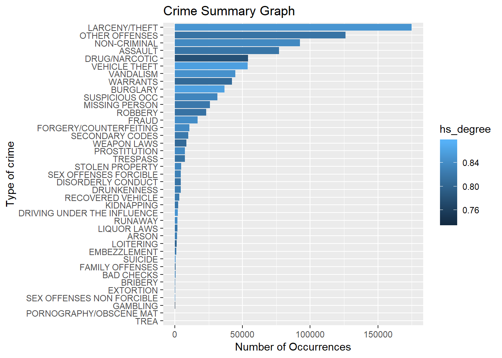

# Crime risk modeling

Exploratory analysis and a support vector model of crime risk in San Francisco, using crime reports and local demographics.

## Course

IST 687, Introduction to Data Science. The class is an introduction to data science in R, covering data management, transformation, analysis, and machine learning.

## Team

Group 3. Individual teammate names were not listed in the files.

## Problem

The idea was a model that estimates the chance of experiencing a crime on the way back to your car, given a location, a date, and a time window. We also looked at whether age, income, and divorce rates show up in the crime data.

## Data

We joined several sources ahead of time into one table with 878,049 rows and 63 columns:

- San Francisco crime data from the Kaggle SF Crime competition
- NCESSCH education data
- Gazetteer files
- 5-year ACS demographics

NYC crime data was considered and dropped because it was only available in aggregate. The joined CSV is not in this folder. The Rmd still points at the path I used on my machine at the time.

## Approach

Most of the notebook is exploratory: crime counts, maps in leaflet, income and day of week, graduation rates, and home ownership. Larceny and theft were the most common categories before we narrowed the data. After filtering to descriptions involving homicide, gangs, shootings, guns, knives, or a deadly weapon, assault was the largest remaining category. Zip code 94102 stood out in the income plots.

The target was built by rolling records up by area and turning counts, population, and the date range into a crime-per-day value. A support vector machine (`ksvm`) was trained with 5-fold cross-validation. Inputs included graduation rate, median income, age, unemployment, divorce, home ownership, and a few derived ratios. I did not leave a numeric error score in the files, so I am not quoting one here.

## Tools

R and RStudio. The Rmd uses ggplot2, leaflet, dplyr, kernlab, caret, e1071, and the other packages listed at the top of the file.

## Files

- `code/crime-risk-analysis.Rmd` (titled Project Update 3)
- `reports/update-2.html`: an earlier knitted draft, which is also where the chart above comes from
- `images/crime-by-category.png`
