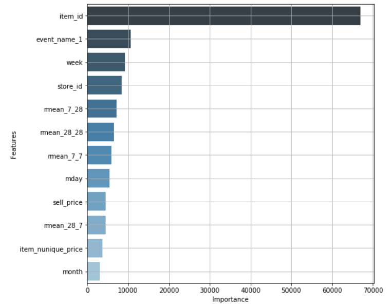
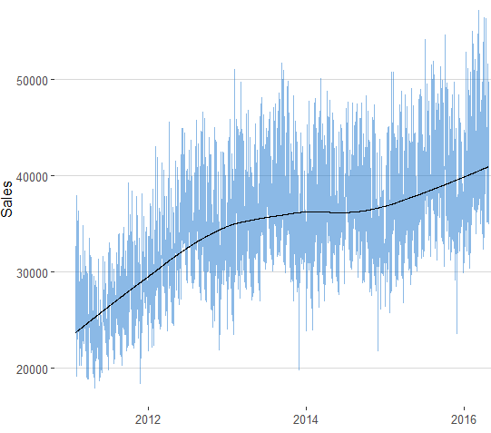
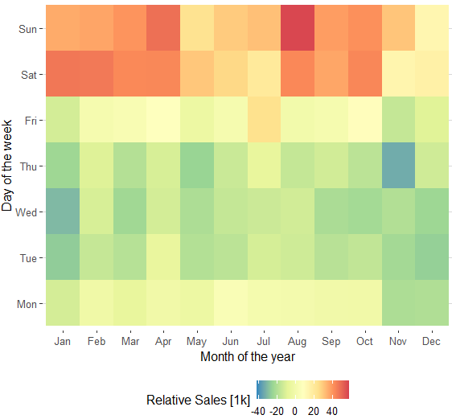

# Retail sales forecasting

Daily unit sales forecasts for 3,049 Walmart products in 10 stores, 28 days ahead, using the M5 competition data. In a rolling-origin backtest over three 28-day windows, the LightGBM model averaged a WRMSSE of 0.6375, against 0.8938 for a seasonal naive forecast and 1.0766 for a 28-day moving average.

## Course

IST 707, Data Analytics (now called Applied Machine Learning). The course covers data mining methods, including data preparation, association rules, clustering, classification, and evaluation, applied to business problems, and ends with a project. I did this project on my own in 2020.

## Problem

The M5 competition asks for a forecast of the units each item sells in each store on each of the next 28 days. The data covers 10 stores in California, Texas, and Wisconsin. Better item-level forecasts help with ordering and getting stock to the right store.

## Data

The M5 accuracy files from Kaggle:

- `sales_train_evaluation.csv`: daily unit sales for 30,490 item and store series, d_1 (2011-01-29) through d_1941 (2016-05-22)
- `sell_prices.csv`: weekly price for each item and store
- `calendar.csv`: dates, holidays and events, and SNAP days for each state

The data is not in the repo. The competition rules do not allow redistribution, and the sales and price files are over 100 MB each.

## Approach

The original project had three parts.

- A pandas pipeline (`src/m5_forecasting/features.py`) that unpivots the sales table, joins prices and the calendar, and builds features: 7 and 28 day lags, rolling means of those lags, date parts, events, SNAP flags, price, how many prices an item has had, how many items a store sells at a price, and the item's mean and standard deviation of sales.
- Clustering (k-means in Python, hierarchical in R) and classifiers (naive Bayes, decision tree, SVM) used to explore what drives sales. The main finding was that stores and items with a stable product line and price history sell more, which led to the price count features. The SVM weekday classifier in the notebook left its label in the inputs, so its accuracy does not mean much.
- A LightGBM model with a Tweedie objective (learning rate 0.075, 128 leaves, 1,250 rounds) that forecasts one day at a time and feeds each day's predictions back in as lags for the next day.

The original validation used 2 million rows drawn at random from the training data, and the item encodings and price counts were computed over the whole history. That lets the model see the same days it is scored on, so the validation RMSE in the notebook (2.031) is optimistic and is not comparable to a real forecast.

`src/m5_forecasting/backtest.py` replaces that check with a rolling-origin backtest. For each origin it:

1. computes the price counts and item mean and standard deviation from the 365 days up to the origin only,
2. trains LightGBM with the original settings on those 365 days (about 11.1 million item and day rows where the item was on sale),
3. forecasts the next 28 days recursively, as the original notebook did, and
4. scores the forecast against the actual sales, next to two simple baselines.

The baselines are a seasonal naive forecast (repeat the last observed week) and a flat forecast at each series' mean over the last 28 days. The original notebook also scaled predictions by 1.025 to 1.035. The backtest leaves that out.

## Results

Backtest windows (all 30,490 series, 28 days each):

| Origin (last known day) | Forecast window | Dates |
| --- | --- | --- |
| d_1857 | d_1858-d_1885 | 2016-02-29 to 2016-03-27 |
| d_1885 | d_1886-d_1913 | 2016-03-28 to 2016-04-24 |
| d_1913 | d_1914-d_1941 | 2016-04-25 to 2016-05-22 |

| Window | Model | RMSE | WAPE | WRMSSE |
| --- | --- | --- | --- | --- |
| d_1858-d_1885 | LightGBM | 2.2818 | 0.7565 | 0.7070 |
| d_1858-d_1885 | Seasonal naive | 2.7603 | 0.8788 | 0.8889 |
| d_1858-d_1885 | 28-day average | 2.3073 | 0.7591 | 1.0500 |
| d_1886-d_1913 | LightGBM | 2.0717 | 0.7333 | 0.5398 |
| d_1886-d_1913 | Seasonal naive | 2.7595 | 0.8889 | 0.9228 |
| d_1886-d_1913 | 28-day average | 2.2186 | 0.7509 | 1.0975 |
| d_1914-d_1941 | LightGBM | 2.1568 | 0.7215 | 0.6657 |
| d_1914-d_1941 | Seasonal naive | 2.6769 | 0.8622 | 0.8697 |
| d_1914-d_1941 | 28-day average | 2.2430 | 0.7386 | 1.0823 |
| Mean | LightGBM | 2.1701 | 0.7371 | 0.6375 |
| Mean | Seasonal naive | 2.7322 | 0.8766 | 0.8938 |
| Mean | 28-day average | 2.2563 | 0.7496 | 1.0766 |

RMSE and WAPE are computed on the 30,490 item and store series. WAPE is the sum of absolute errors divided by total units sold. Most items sell zero or a few units on a given day, so item-level WAPE is high for every method. WRMSSE is the competition's metric. It scores the forecast at 12 levels of aggregation (total, state, store, category, department, and so on down to item and store), weights each series by its dollar sales in the 28 days before the origin, and scales errors by each series' naive one-day error.

LightGBM had the lowest error on every window and metric. Against the 28-day average, the gain is small on item-level RMSE and WAPE (about 4% and 2%) and much larger on WRMSSE, which rewards getting weekly patterns and totals right. The seasonal naive forecast does better than the 28-day average on WRMSSE but worse on the item-level measures.

The exact numbers are in `backtest/results.csv`. The most-used features in the last backtest model were item, event name, store, and the rolling means, which is close to the original model's ranking:



From the original analysis, total daily sales trend upward, and weekends sell the most once the trend is removed:





The paper is [reports/final-report.pdf](reports/final-report.pdf), and the slides are [reports/slides.pdf](reports/slides.pdf). I removed one line from the slides that quoted a Kaggle score, because that submission came from running a public notebook and not from this pipeline.

## Credits

The feature pipeline and recursive forecast were adapted from these public Kaggle notebooks, which are also listed in the code:

- "M5 Accuracy: Tweedie is back!" by kernelgenerator: https://www.kaggle.com/kernelgenerator/m5-accuracy-tweedie-is-back
- "M5 custom features", "M5 lags features", and "M5 simple FE" by Konstantin Yakovlev (kyakovlev): https://www.kaggle.com/kyakovlev/m5-custom-features, https://www.kaggle.com/kyakovlev/m5-lags-features, https://www.kaggle.com/kyakovlev/m5-simple-fe
- `r/sales_seasonality.R` builds on "Back to (predict) the future: Interactive M5 EDA" by Heads or Tails: https://www.kaggle.com/headsortails/back-to-predict-the-future-interactive-m5-eda
- `src/m5_forecasting/confusion_matrix_plot.py` is adapted from Wagner Cipriano's pretty confusion matrix example: https://github.com/wcipriano/pretty-print-confusion-matrix

## Running it

Download the data with the Kaggle CLI (you need to accept the competition rules on Kaggle first) and unzip it into `data/raw/`:

```
kaggle competitions download -c m5-forecasting-accuracy
unzip m5-forecasting-accuracy.zip -d data/raw
```

Then, from this folder:

```
pip install -r requirements.txt
python backtest/run_backtest.py --data data/raw
```

The backtest prints each window's results and writes `backtest/results.csv` and `backtest/feature_importance.csv`. It took about 30 minutes on an 8-core machine and used about 2.5 GB of memory while training. `--train-days` and `--rounds` make it smaller for a quick check.

The notebooks in `notebooks/` switch to this folder and add `src/` to the path in their first cell. The R scripts in `r/` expect to be run from this folder too. `data/` and `models/` are in `.gitignore`.

## Tools

Python, pandas, NumPy, LightGBM, scikit-learn, SciPy, R (e1071, rpart, caret, ggplot2), and Plotly.

## Files

```
README.md
requirements.txt
backtest/
    run_backtest.py
    results.csv
    feature_importance.csv
src/m5_forecasting/
    data_loader.py              loads and joins the raw files
    features.py                 feature pipeline used by the notebooks
    backtest.py                 rolling-origin backtest and metrics
    clustering.py               k-means score tracking
    confusion_matrix_plot.py
notebooks/
    forecast.ipynb
    clustering.ipynb
    classification.ipynb
    data_curation.ipynb         saves samples for the R scripts
r/
    sales_seasonality.R
    decision_tree.R
    naive_bayes.R
    knn.R
    hierarchical_clustering.R
    kmeans_analysis.R
reports/
    final-report.pdf
    slides.pdf
images/
    original-feature-importance.png
    total-daily-sales.png
    relative-sales-heatmap.png
```
