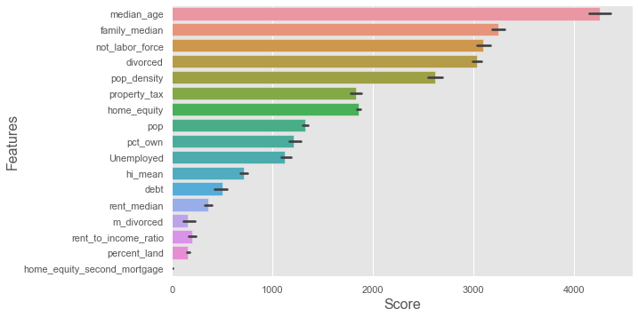

# Predicting high school graduation rates

Census and related data used to model high school graduation rates and to see which local conditions moved with them.

## Course

IST 718, Big Data Analytics. The course covers analysis of large datasets with Python and Spark, including machine learning, and includes a final project.

## Team

Group 8: Brett Bastianelli, Alex Geiger, Maria Ng, and Samantha White (the notebook lists her as Sam White).

## Problem

We wanted to model graduation rates from census and related data, and to look at zip codes and tracts that sit well below the national rate. The report cites an NCES figure of 88% for the U.S. rate in the 2021-2022 school year.

## Data

Census files were pulled from www2.census.gov (gazetteer files, census tables, and column-name files) and combined with property tax and lottery revenue. After cleaning, each row was a U.S. zip code; there were 18,333 of them. Missing values were set to 0, and duplicates were collapsed by taking the median within zip code. For the later LightGBM work we switched to census tracts, which are smaller (about 3.8 tracts per zip code on average). After dropping rows with missing features or a near-zero graduation rate, 70,027 tracts remained.

## Approach

- OLS on zip codes, with the graduation rate squared, using divorced, median age, family median income, population, state, not in the labor force, and elderly.
- LightGBM with 5-fold cross-validation, trained on tracts.

A random forest was also fit in the notebook. The error it produced was far lower than the other models, so I am not quoting it.

## Results

The zip-code OLS model had an adjusted R-squared of 0.619.

The LightGBM models, averaged across the five test folds, had MAE 0.044, MAPE 0.058, and RMSE 0.063. Median age was the strongest feature, followed by median family income and the share of people not in the labor force. Age and family income were both positively related to graduation rates.

We also used the models to look at a census tract in Salinas, California, with a 28% graduation rate, and at how the prediction moved if family income or median age changed. The writeup discusses tax incentives and job fairs as possible responses.

The paper is [reports/final-report.pdf](reports/final-report.pdf). Slides and a knitted copy of the notebook are in `reports/` as well.

## Tools

Python, pandas, scikit-learn, LightGBM, statsmodels, and seaborn.

## Files

- `code/graduation-rates-analysis.ipynb`
- `reports/final-report.pdf`
- `reports/slides.pdf`
- `reports/analysis-notebook.html`
- `images/feature-importance.png`
