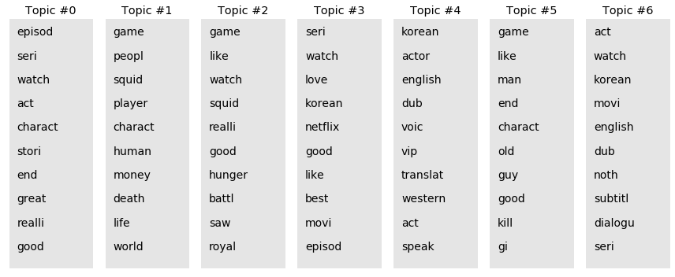

# Squid Game sentiment

Sentiment models on IMDb reviews and tweets about Squid Game, plus topic modeling of the reviews.

## Course

IST 736, Text Mining. The course introduces methods for finding patterns in large text collections and applying them to problems such as business intelligence and social behavior analysis.

## Team

Alex Geiger, Kyle Walter, Eric Arnold, and John Hoyle.

## Problem

The setup was a client brief: Netflix had picked up Squid Game and wanted a read on public sentiment before committing to another season. We trained sentiment models on IMDb reviews, applied them to tweets, and used LDA to see what people talked about.

## Data

- 1,186 IMDb user reviews (Kaggle), with star ratings used as labels
- 80,019 tweets about the show (also from Kaggle)

IMDb scores were heavily skewed high. We binned stars into five labels: very negative (1-5), negative (6-7), neutral (8), positive (9), and very positive (10).

## Approach

Reviews were cleaned (stop words, stemming, and so on) and a multinomial naive Bayes model was tuned on those features. The setting that worked best used the `lem_review_rm_sw_stem` text and an alpha of 0.93. An SVM was tried as well and did slightly worse on test accuracy, so the naive Bayes models were the ones applied to the tweets. LDA was fit with 7 topics on the IMDb reviews.

## Results

With cross-validation, the naive Bayes model had a test accuracy of 0.431 and a test kappa of 0.284 (five classes). Train accuracy was much higher (0.943), so the model overfit.

Applied to the tweets, predicted sentiment was higher than on the IMDb reviews: an average of 7.9 vs 7.2 on the 1-10 star scale.

Average star ratings by LDA topic:

- Topic 3 scored highest at 8.11. The writeup ties this to the human and emotional side of the show.
- Topic 6 scored lowest at 6.73 and was about poor English dubbing.
- Topic 5 (6.80) was about main characters being killed off.

The report concludes that public sentiment was strongly positive, and more positive in the Twitter data than in the IMDb ratings, which supported funding a second season. It also suggested spending more on English dubbing, keeping characters the audience had gotten attached to, and staying with the human side of the story.

## Tools

Python, scikit-learn (MultinomialNB, SVM, LatentDirichletAllocation), and NLTK.

## Files

- `code/squid-game-sentiment.ipynb`
- `reports/final-report.html`
- `images/lda-topics.png`
