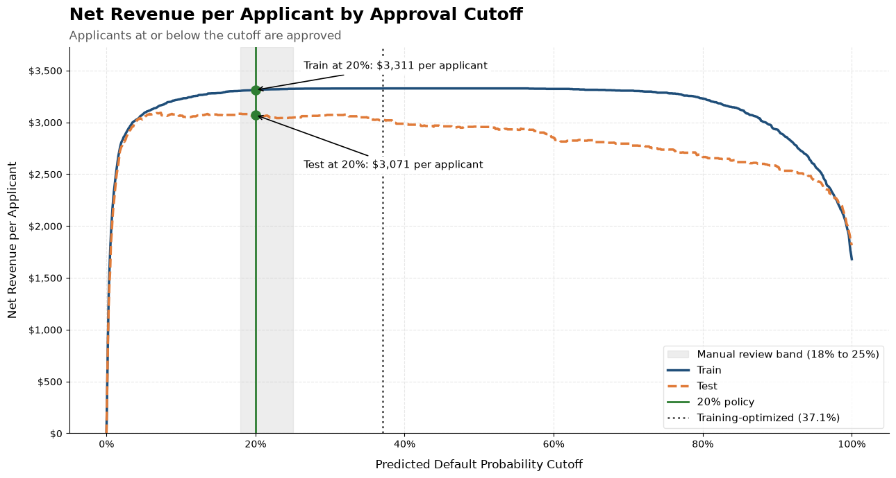
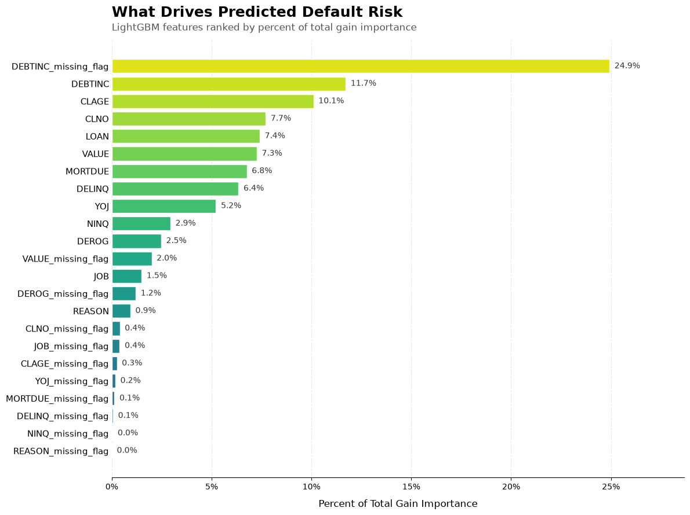
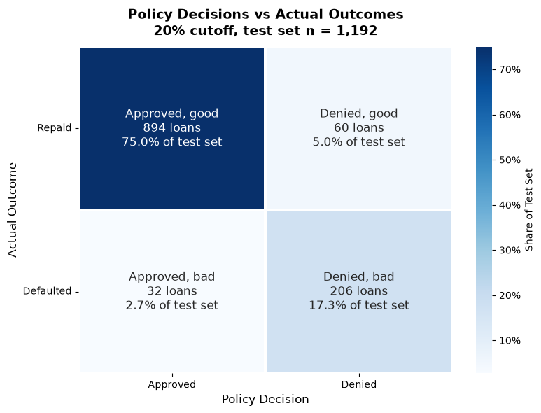

# Loan default prediction

A LightGBM model that predicts the probability a home equity loan applicant will default, and a 20% cutoff that turns that probability into an approve or deny decision. Applied to the test set and scaled to the full dataset, the policy raises estimated net revenue from $10.17M (approving everyone) to $18.30M, an uplift of about $8.13M, while approving 77.7% of applicants.

## Program

This was my capstone project for the MIT Professional Education Applied AI and Data Science Program, completed on my own in 2026.

## Problem

A retail bank approves home equity loans through a manual review, and about 20% of approved loans default. A default costs much more than a good loan earns, so the goal was a model that flags likely defaults before approval and a decision rule that can be measured in dollars.

## Data

The HMEQ dataset: 5,960 past home equity loans, each with the outcome (`BAD` = 1 if the borrower defaulted) and 12 applicant attributes such as loan amount, mortgage balance, property value, job, years on the job, delinquencies, credit inquiries, age of oldest credit line, and debt-to-income ratio.

It is available on Kaggle: https://www.kaggle.com/datasets/ajay1735/hmeq-data. The CSV is not in this repo.

The dollar figures assume a loan that is repaid earns 22% of the loan amount and a loan that defaults loses 48.7%.

## Approach

1. Log transform the most skewed fields and cap outliers instead of dropping rows.
2. Add a missing value flag for every field, then fill counts with 0, categories with "Missing", and financial fields with the median.
3. Split 80/20, stratified on the outcome and two missing data patterns.
4. Train LightGBM with hyperparameters from an earlier cross-validated search.
5. Compare net revenue across approval cutoffs from 0 to 1, using the training data to find the best cutoff and the test set to compare it with a 20% policy.
6. Scale the test set results to the full dataset and compare them with approving every loan.

## Results

| Metric | Value |
| --- | --- |
| Test AUC | 0.971 |
| Test PR-AUC | 0.908 |
| Test log loss | 0.180 |
| Approval rate at 20% cutoff (test set) | 77.7% |
| Current net revenue, approve all | $10.17M |
| Model policy net revenue (estimate) | $18.30M |
| Estimated uplift | $8.13M |

The cutoff that maximized net revenue on the training data was 0.371. On the test set the 20% cutoff did slightly better ($3,070.68 per applicant vs $3,019.63) and is the more conservative starting point. The notebook recommends a pilot at three branches with applications between 18% and 25% sent to manual review.

Training AUC reached 1.0, so the model fits the training data very closely. The test results held up, but this is listed as a risk to watch in the pilot, along with selection bias (the data only contains loans that were approved), explainability, and fairness.







## Running it

Download `hmeq.csv` from the Kaggle link above and put it in this folder, next to the notebook. Then:

```
pip install -r requirements.txt
jupyter notebook loan_default_prediction.ipynb
```

The notebook runs top to bottom in under a minute.

## Files

```
README.md
requirements.txt
loan_default_prediction.ipynb
images/
    net-revenue-by-cutoff.png
    feature-importance.png
    policy-confusion-matrix.png
```
